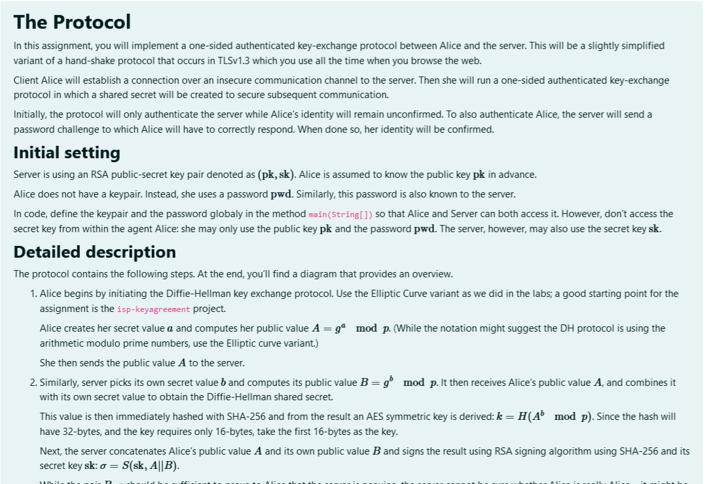
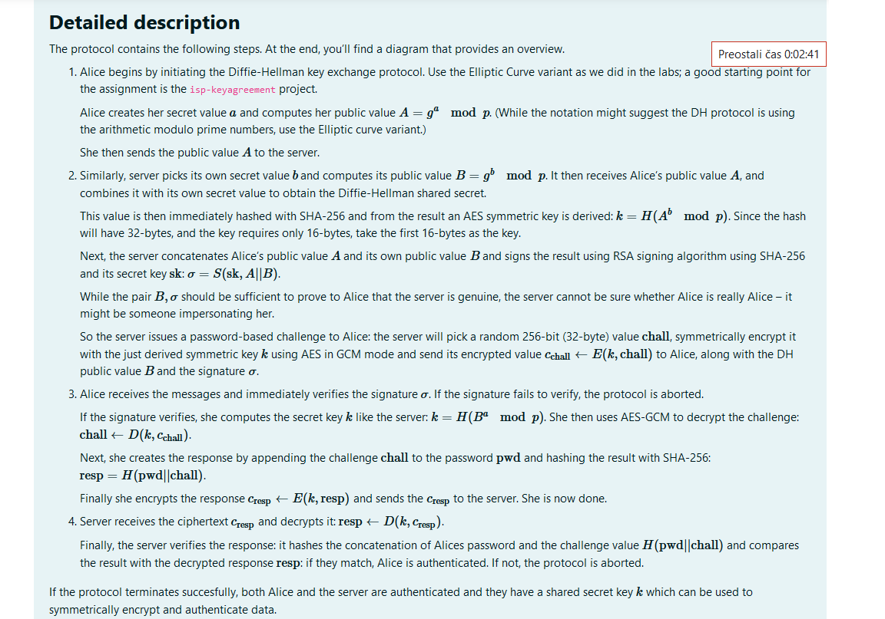

# Lab 5: Midterm 1 — authenticated key exchange

This midterm combines the earlier labs into a simplified handshake between
Alice and a server. The supplied `Midterm1KeyExchange` implementation uses
elliptic-curve Diffie–Hellman (ECDH), RSA signatures, SHA-256, AES-GCM, and a
password challenge. The server is the second participant in this lab; it takes
the role usually assigned to Bob in the other labs.

## Files

| File | Purpose |
| --- | --- |
| [Midterm1KeyExchange.java](src/main/java/isp/kolokvij/Midterm1KeyExchange.java) | Complete implementation with line-by-line explanations of Alice and the server. |
| [Protocol and initial setting](src/main/java/isp/kolokvij/Screenshot_2023-11-20_at_18-58-27_Midterm_1_Programming_assignment.png) | Original assignment screenshot covering the protocol, initial keys, and start of the handshake. |
| [Detailed protocol](src/main/java/isp/kolokvij/izpit.png) | Original screenshot with all four protocol steps. |
| [pom.xml](pom.xml) | Maven configuration from the key-agreement lab, including the agent communication dependency. |

## Initial setting

The server has a long-term RSA key pair. Alice knows its authentic RSA public
key in advance. Alice and the server also share a password, `pwd`. The RSA key
pair and password are defined in `main()` so both agents can use the required
values. Alice uses only the RSA **public** key and the password; the server uses
the RSA private key to sign.

Each participant generates a separate temporary EC key pair for this exchange.
The RSA keys authenticate the server, while the EC keys establish the shared
secret. The modular-exponent notation in the assignment represents the
agreement concept; this implementation uses the required elliptic-curve variant.

## Protocol, step by step

1. **Alice sends A.** Alice generates her temporary EC key pair and sends her
   encoded public key `A` to the server. Her private EC key stays local.
2. **The server derives the key and sends a signed challenge.** The server
   decodes `A`, generates a compatible EC key pair, and computes the ECDH shared
   secret. It hashes the secret with SHA-256 and takes the first 16 bytes as the
   AES-128 key `k`. It signs the encoded bytes `A || B`, in that order, using
   `SHA256withRSA` and its RSA private key. It generates a random 32-byte
   challenge and encrypts it with AES-GCM. It sends `B`, the signature, the
   challenge IV, and the challenge ciphertext with its authentication tag.
3. **Alice verifies the server and answers.** Alice verifies the signature over
   `A || B` using the server's known RSA public key and aborts if verification
   fails. She derives the same AES key using ECDH and SHA-256, decrypts the
   challenge, and checks its length. She computes
   `resp = SHA-256(UTF-8(pwd) || challenge)`, encrypts the response with AES-GCM
   using a fresh IV, and sends the response IV and ciphertext.
4. **The server verifies Alice.** The server decrypts the response, independently
   computes the expected password-and-challenge hash, and compares the two
   digests using `MessageDigest.isEqual`. A mismatch aborts the exchange; a
   match prints `Alice authenticated successfully!` in the server's output.

`||` means byte concatenation. Two consecutive `Signature.update()` or
`MessageDigest.update()`/`digest()` calls preserve this ordering without needing
a separate combined array. An IV is public, but AES-GCM must never reuse an IV
with the same key. The ciphertext returned by `doFinal()` includes the GCM tag.

## Setup and running

Use JDK 21 and Maven 3, as in the other labs. Download `pom.xml` and the Java
file, retaining the `src/main/java/isp/kolokvij/` package directory. From the lab
directory, compile:

```sh
mvn compile
```

Open the directory as a Maven project in your IDE and run
`isp.kolokvij.Midterm1KeyExchange`. The first Maven build downloads the
communication library from JitPack. Successful output includes Alice's valid
server-signature message and the server's successful authentication message.
Alice's final send alone does not confirm that the server accepted her response.

## Reading the code

Follow Alice's sends alongside the server's receives, in exactly the same order.
Distinguish the RSA identity keys, temporary EC keys, derived AES key, signature,
IVs, challenge, and password response. The comments explain the supplied
implementation; this is a teaching protocol, with its assignment-specific key
derivation and demonstration password.

## Original assignment images

### Protocol and initial setting



### Detailed description


